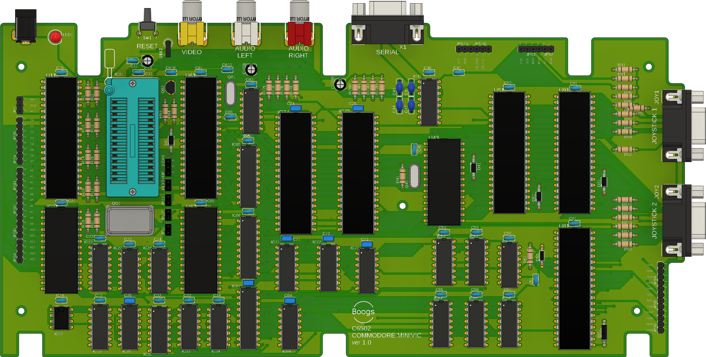
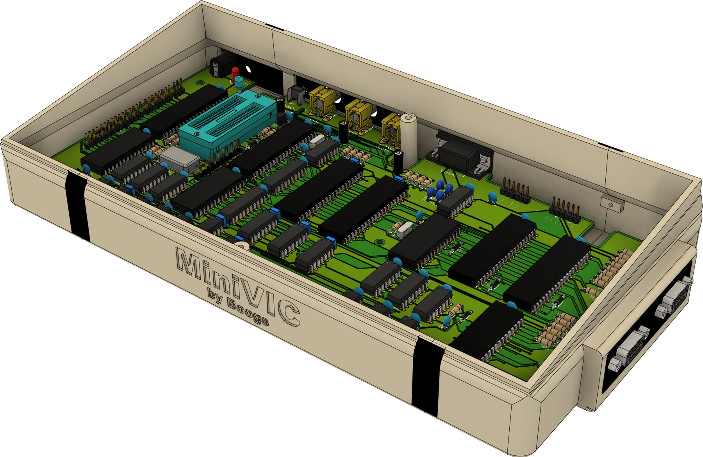
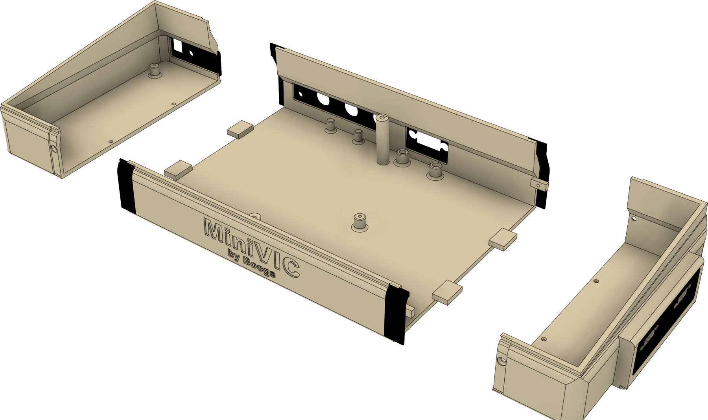
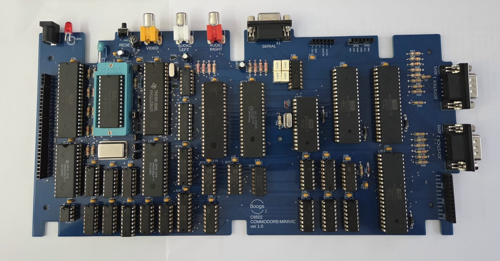
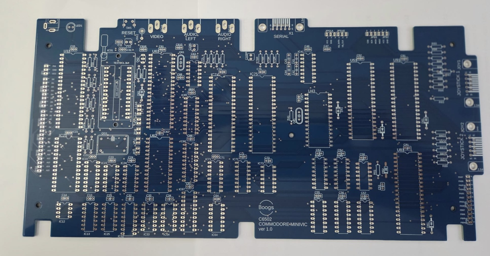
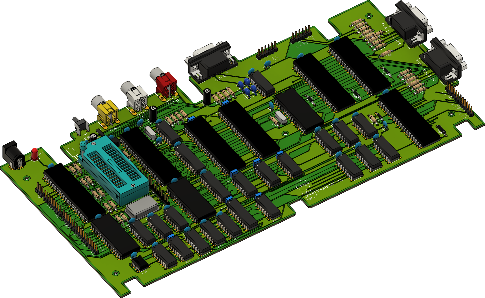
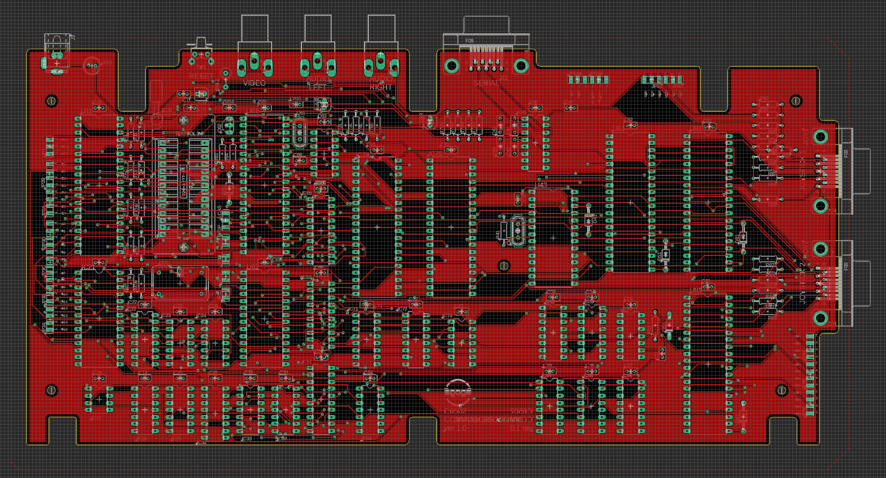

# miniVIC: 65C02-Based Arcade Computer

The **Boogs77-miniVIC** is a compact, arcade-oriented 8-bit computer built on a single board. It takes the modular architecture of the [BO6502 System](https://github.com/Boogs77/BO6502_65C02-based_modular_computer) and puts all of its modules on one PCB: a **W65C02S** CPU, a **TMS9918A** video processor with composite output, two **AY-3-8910** sound chips for stereo audio, a DIN5 keyboard, two joysticks, a serial port and an SD card for programs.

### ▶️ [Try it in the browser emulator](https://boogs77.github.io/BO6502-miniVIC-emulator/) · 📖 [Read the operation manual](https://github.com/Boogs77/miniVIC-manual)

---

## 🧠 System Architecture & Modules

Every section of the board follows the electrical and logical design of a BO6502 module. The full schematic is in [`schematics/miniVIC_C6502_v41.pdf`](schematics/miniVIC_C6502_v41.pdf). The Gerber files of the 2-layer PCB (v52, the version made by JLCPCB) are in [`gerber/C6502_v52_gerber.zip`](gerber/C6502_v52_gerber.zip), with the drill file.

### ⚙️ Core Processing Unit (CPU, RAM, ROM)
* **CPU:** Western Design Center **W65C02S**. Reference: [BO6502 CPU](https://github.com/Boogs77/BO6502_65C02-based_modular_computer/tree/main/BO6502%20CPU).
* **Clock:** **1 MHz** crystal oscillator; the same clock drives the two AY-3-8910.
* **Reset:** **NE555** power-on and push-button reset. Reference: [BO6502 RESET](https://github.com/Boogs77/BO6502_65C02-based_modular_computer/tree/main/BO6502%20RESET).
* **RAM:** **HM62256** 32KB static RAM. Reference: [BO6502 RAM](https://github.com/Boogs77/BO6502_65C02-based_modular_computer/tree/main/BO6502%20RAM).
* **ROM:** **28C256** 32KB EEPROM on a ZIF socket, so the firmware can be updated without tools. Reference: [BO6502 ROM](https://github.com/Boogs77/BO6502_65C02-based_modular_computer/tree/main/BO6502%20ROM).
* **Interrupts:** the VIAs and the ACIA share **IRQ** through Schottky diodes; the video interrupt drives **NMI**.

### 📺 Video (TMS9918A)
* **Output:** composite video on an RCA connector, 256x192 pixels, 15 colours, 32 sprites.
* **VRAM:** 16KB on an **HM62256** static RAM, with two **74HC574** latches for the row/column address and a **74HC245** data buffer.
* **Addressing:** **$B000** (data) and **$B001** (registers/status); the vertical blank interrupt goes to **NMI** (60 Hz).
* **Reference:** [BO6502 VDU](https://github.com/Boogs77/BO6502_65C02-based_modular_computer/tree/main/BO6502%20VDU).

### 🔊 Audio (2 x AY-3-8910)
* **Output:** stereo, one chip per channel, each with its three voices mixed on an RCA connector.
* **Right channel:** latch **$D380**, write **$D381**.
* **Left channel:** latch **$D384**, write **$D385**.
* **Reference:** [BO6502 AUDIO](https://github.com/Boogs77/BO6502_65C02-based_modular_computer/tree/main/BO6502%20AUDIO).

### ⌨️ Keyboard Input (DIN5)
* **Connector:** 5-pin DIN for AT keyboards with the US layout; a PS/2 keyboard works through a passive adapter.
* **Interface:** a **W65C22** VIA reads the keyboard through two **74HCT595** shift registers: each scancode arrives on PORTA, with a strobe on CA1.
* **Addressing:** **$D180**.
* **Reference:** [BO6502 KEYb](https://github.com/Boogs77/BO6502_65C02-based_modular_computer/tree/main/BO6502%20KEYb).

### 🕹️ Joysticks (W65C22 VIA)
* **Connectors:** two DB9 ports for Sega Master System style joysticks, with pull-up resistors.
* **Player 1:** PORTA at **$D581**. **Player 2:** PORTB at **$D580**.
* **Bits:** UP (bit0), DOWN (bit1), LEFT (bit2), RIGHT (bit3), button 1 (bit4), button 2 (bit5).
* **Reference:** [BO6502 JOYSTICK](https://github.com/Boogs77/BO6502_65C02-based_modular_computer/tree/main/BO6502%20JOYSTICK).

### 💾 SD Card (W65C22 VIA)
* **Interface:** SPI bit-banged on PORTA (MISO, MOSI, SCK, CS), with a header for an SD card module.
* **Addressing:** **$DD80**.
* **Cards:** SDSC and SDHC, read and write (BIOS KEYB/SD).
* **Reference:** [BO6502 SDCard](https://github.com/Boogs77/BO6502_65C02-based_modular_computer/tree/main/BO6502%20SDCard).

### 🔌 Serial Communication
* **Interface:** **W65C51** ACIA with a 1.8432 MHz crystal and a **MAX232** on a DB9 connector.
* **Addressing:** **$C000**.
* **Reference:** [BO6502 SERIAL](https://github.com/Boogs77/BO6502_65C02-based_modular_computer/tree/main/BO6502%20SERIAL).

### 🧩 Expansion
* Pin headers bring out the address bus, the data bus and PHI0, and the free lines of the SD card VIA.
* **Power:** 5V DC regulated, on a barrel jack with a power LED.

---

## 🗺️ Memory Map

| Address | Size | Device |
| :--- | :--- | :--- |
| **$0000-$7FFF** | 32KB | RAM |
| **$8000-$AFFF** | 12KB | ROM (Microsoft BASIC, BIOS) |
| **$B000** | page | VDU · TMS9918A |
| **$C000** | page | Serial I/O · W65C51 |
| **$D180** | 16 bytes | Keyboard · W65C22 |
| **$D380** | 8 bytes | Audio · 2x AY-3-8910 |
| **$D580** | 16 bytes | Joysticks · W65C22 |
| **$DD80** | 16 bytes | SD Card · W65C22 |
| **$E000-$FFFF** | 8KB | ROM (boot menu, jump table, WozMon, vectors) |

The ROM chip covers **$8000-$FFFF**, but the I/O area **$B000-$DFFF** is decoded to the devices.

---

## 🔌 Connector Pinouts

From the schematic [`miniVIC_C6502_v41.pdf`](schematics/miniVIC_C6502_v41.pdf). The pin numbers are the ones of the schematic symbols.

### ⌨️ Keyboard (JP51A, JP51B)
The keyboard header is wired to a DIN5 socket for an AT keyboard with the US layout. The keyboard used for the tests is a **BTC 5100**.

| Header pin | Signal | DIN5 pin (AT keyboard) |
| :--- | :--- | :--- |
| **JP51A-1** | +5V | 5 |
| **JP51A-2** | GND | 4 |
| **JP51A-3** | not connected | |
| **JP51B-1** | not connected | |
| **JP51B-2** | KB_DATA | 2 |
| **JP51B-3** | KB_CLK | 1 |

### 🕹️ Joysticks (JOY1, JOY2)
Two DB9 connectors, Sega Master System standard. Every contact closes to ground, and the 4.7k pull-up resistors are on the board; +5V is not brought to the connector.

| DB9 pin | Signal | JOY1 (player 1) | JOY2 (player 2) |
| :--- | :--- | :--- | :--- |
| **1** | Up | **$D581** bit 0 (PA0) | **$D580** bit 0 (PB0) |
| **2** | Down | **$D581** bit 1 (PA1) | **$D580** bit 1 (PB1) |
| **3** | Left | **$D581** bit 2 (PA2) | **$D580** bit 2 (PB2) |
| **4** | Right | **$D581** bit 3 (PA3) | **$D580** bit 3 (PB3) |
| **5** | not connected | | |
| **6** | Button 1 | **$D581** bit 4 (PA4) | **$D580** bit 4 (PB4) |
| **7** | not connected | | |
| **8** | GND | GND | GND |
| **9** | Button 2 | **$D581** bit 5 (PA5) | **$D580** bit 5 (PB5) |

The symbols in the schematic number these pins in mirror order (JOY pin 1 is pin 5 in the schematic, 2 is 4, 3 is 3, 4 is 2, 5 is 1, 6 is 9, 7 is 8, 8 is 7 and 9 is 6).

### 💾 SD Card (JP92, JP93)
One 6-pin header for an SD card module, SPI bit-banged on the SD VIA.

| Header | Pin | Signal | VIA |
| :--- | :--- | :--- | :--- |
| **JP92** | 1 | GND | |
| **JP92** | 2 | +5V | |
| **JP92** | 3 | MISO | PA1 |
| **JP93** | 1 | MOSI | PA2 |
| **JP93** | 2 | SCK | PA3 |
| **JP93** | 3 | CS | PA4 |

### 🔌 Serial (X1)
DB9 connector with a **MAX232** (RS-232 levels), 19200 baud, 8 data bits, no parity, 1 stop bit. CTS, DCD and DSR of the W65C51 are tied to ground, so there is no hardware flow control.

### 🧩 Expansion headers
| Header | Pins 1-4 |
| :--- | :--- |
| **JP1** | 1 +5V · 2 GND · 3 PHI0 |
| **JP2A** | D7 · D6 · D5 · D4 |
| **JP2B** | D3 · D2 · D1 · D0 |
| **JP3A** | A15 · A14 · A13 · A12 |
| **JP3B** | A11 · A10 · A9 · A8 |
| **JP3C** | A7 · A6 · A5 · A4 |
| **JP3D** | A3 · A2 · A1 · A0 |
| **JP94** | PA0 · PA5 · PA6 · PA7 (SD VIA, port A) |
| **JP95** | PB0 · PB1 · PB2 · PB3 (SD VIA, port B) |
| **JP96** | PB4 · PB5 · PB6 · PB7 (SD VIA, port B) |

### 🔋 Power
5V regulated DC on a barrel jack (J1), with a red power LED.

---

## ✅ Tested Hardware

The miniVIC is fully tested on the real board: video, audio, SD card, joysticks, serial port and keyboard, all working.

---

## 💻 Software & Firmware

The firmware is published in its own repository: **[miniVIC BIOS](https://github.com/Boogs77/miniVIC_bios)** (`bin/boogs.bin`, the 32KB EEPROM image). The current version is **16.11.26 KEYB/SD R2**.

At power-on the BIOS shows a menu on the video output and on the serial terminal:
1. **WozMon**, the Apple I monitor.
2. **Microsoft BASIC 1977**.
3. **SD card programs menu**: GAMES, APPS, SOUNDS or ALL PROGRAMS, on several pages, started with one key.
4. **System information**.

Programs loaded from the SD start at **$1000**, with an NMI trampoline at **$0FD0** that the BIOS calls on every vertical blank. They call the BIOS only through the jump table at **$FD00**: its addresses never move.

| Address | Entry | Function |
| :--- | :--- | :--- |
| **$FD00** | `JT_CHROUT` | print the character in A |
| **$FD03** | `JT_CHRIN_NOECHO` | read a key: C=1 and A=key, C=0 if none |
| **$FD06** | `JT_RESET_TERM` | reset the serial terminal |
| **$FD09** | `JT_INIT_CRT` | reset the video cursor |
| **$FD0C** | `JT_LOAD_RUN_SLOT` | load and run the SD program in slot A |
| **$FD0F** | `JT_SHOW_MENU` | back to the BIOS menu |
| **$FD12** | `JT_INIT_SDCARD` | load the SD program in slot A and return |
| **$FD15** | `JT_FLUSH_KB` | empty the keyboard buffer |
| **$FD18** | `JT_SD_READ_SECTOR` | read a 512 byte SD sector |
| **$FD1B** | `JT_SD_WRITE_SECTOR` | write a 512 byte SD sector |
| **$FD1E** | `JT_SD_INIT` | initialize the SD card |
| **$FD21** | `JT_KB_SET_MODE` | classic or extended keyboard (arrows, F1-F12, Ctrl, Alt) |

---

## 📖 Operation Manual

The **[miniVIC Operation Manual](https://github.com/Boogs77/miniVIC-manual)**, in the style of the 1976 Apple-1 manual, describes the whole machine: specification, memory and device maps, address decoding, the schematic, the BOM, every register of the chips, the BIOS and its menus, WozMon, Microsoft BASIC, the applications, the games and the SD card format. It covers BIOS **16.11.26 KEYB/SD R2**.

| Language | Screen edition | Print edition |
| :--- | :--- | :--- |
| English | [MiniVIC_Manual_EN.pdf](https://github.com/Boogs77/miniVIC-manual/blob/main/MiniVIC_Manual_EN.pdf) | [MiniVIC_Manual_EN_print.pdf](https://github.com/Boogs77/miniVIC-manual/blob/main/MiniVIC_Manual_EN_print.pdf) |
| Italian | [MiniVIC_Manual_IT.pdf](https://github.com/Boogs77/miniVIC-manual/blob/main/MiniVIC_Manual_IT.pdf) | [MiniVIC_Manual_IT_print.pdf](https://github.com/Boogs77/miniVIC-manual/blob/main/MiniVIC_Manual_IT_print.pdf) |

The screen edition has cream paper and colour pictures, the print edition white paper and grey pictures.

---

## 🎮 Games & Applications

* **[miniVIC Games](https://github.com/Boogs77/miniVIC_games):** a collection of arcade games in 65C02 assembly, with stereo music and records saved on the SD card.
* **[miniVIC Apps](https://github.com/Boogs77/miniVIC_apps):** office applications (Write, Calc, File, Desk, Term, Asm, Mon, Disk, Jukebox).
* **[miniVIC Music](https://github.com/Boogs77/miniVIC_music):** songs for the two AY-3-8910, as programs for the SD card.
* **[BO6502 SD Builder](https://github.com/Boogs77/bo6502-SDbuilder):** Python tools that build the RAW SD card image with the games, applications and songs for the BIOS menu.
* **[BO6502 · miniVIC Emulator](https://github.com/Boogs77/BO6502-miniVIC-emulator):** runs the real BIOS, the games and the applications in the browser.

---

## 🏗️ Enclosure (in development)

A 3D-printed case in the style of the Commodore 64: bone-coloured, with black bands and the engraved lettering "MiniVIC by Boogs". It is designed in Autodesk Fusion.

  
  

* **Size:** 302.3 x 153.0 x 52.5 mm (L x W x H). The back, with the connectors, is the tallest side; the front is lower, about 35.6 mm.
* **Open on top:** the keyboard rests on the rim of the case and works as the lid.
* **Three parts** along the length, joined with tabs and self-tapping screws: the joystick end, the centre part and the power end, so that each one fits on a 250 x 250 mm print bed. Four black panels hold the connectors (serial, RCA and reset, power and LED, joysticks) and four black bands cover the joints.
* **Printing:** PLA on an Anycubic Kobra S1.
* **Status:** the first test print is under way and the joints do not fit perfectly yet, so the STL files are not published. They will be added when the fit is verified.

---

## 📋 Bill of Materials (BOM)

195 parts in total, including the IC sockets and the EEPROM. The complete list, with the designators, is in [`bom/miniVIC_BOM.csv`](bom/miniVIC_BOM.csv).

### Integrated circuits
| Component | Description | Quantity |
| :--- | :--- | :--- |
| **W65C02S** | CMOS 8-bit Microprocessor | 1 |
| **HM62256** | 32K x 8 Static RAM (RAM and VRAM) | 2 |
| **28C256** | 32K x 8 EEPROM (on a 28-pin ZIF socket) | 1 |
| **TMS9918A** | Video Display Processor | 1 |
| **AY-3-8910** | Programmable Sound Generator | 2 |
| **W65C22 (VIA)** | Versatile Interface Adapter (keyboard, joysticks, SD) | 3 |
| **W65C51 (ACIA)** | Asynchronous Communications Interface Adapter | 1 |
| **MAX232** | RS-232 Line Driver | 1 |
| **NE555** | Timer (Reset Circuit) | 1 |
| **74AC138** | 3-to-8 Decoder | 7 |
| **74HC08** | Quad AND Gate | 4 |
| **74HCT00** | Quad NAND Gate | 2 |
| **74HC32** | Quad OR Gate | 1 |
| **74HCT04 / 74HC04** | Hex Inverter | 1 + 1 |
| **74HCT14** | Hex Schmitt Trigger Inverter | 1 |
| **74HCT595** | 8-bit Shift Register | 2 |
| **74HC574** | Octal D Flip-Flop | 2 |
| **74HC245** | Octal Bus Transceiver | 1 |

### Passive components
| Component | Value | Quantity |
| :--- | :--- | :--- |
| **Resistors** (0207, axial) | 75 Ohm · 330 Ohm · 470 Ohm | 1 · 2 · 1 |
| | 1k · 3.3k · 4.7k | 7 · 5 · 12 |
| | 10k · 15k · 47k · 1M | 6 · 1 · 1 · 2 |
| **Ceramic capacitors** | 20p · 33p | 1 · 2 |
| | 100n (decoupling) | 38 |
| | 1u | 4 |
| **Electrolytic capacitors** | 10uF | 3 |
| **Diodes** | SB140 (Schottky) · 1N4148 | 5 · 1 |
| **Ferrite bead** | | 1 |

### Other components
| Component | Description | Quantity |
| :--- | :--- | :--- |
| **2N4401** | NPN Transistor (video output) | 1 |
| **LED** | Red 5mm (power) | 1 |
| **Oscillator** | 1 MHz, DIL14 | 1 |
| **Crystals** | 10.738635 MHz (video), 1.8432 MHz (serial) | 1 + 1 |
| **IC sockets** | DIP 40 pin · 28 pin · 20 pin · 16 pin · 14 pin · 8 pin (one per IC) | 7 · 3 · 3 · 10 · 10 · 1 |
| **ZIF socket** | 28 pin, for the 28C256 EEPROM | 1 |
| **Connectors** | DB9 female (serial, 2x joystick) | 3 |
| | RCA (video yellow, audio left white, audio right red) | 3 |
| | DIN5 keyboard, SD card module, DC jack (SPC4078) | 1 + 1 + 1 |
| **Switch** | Tactile push-button (reset) | 1 |
| **Pin headers and jumpers** | expansion, keyboard, SD, video and cassette jumpers | 17 + 2 |

--- | :--- | :--- |
| **W65C02S** | CMOS 8-bit Microprocessor | 1 |
| **HM62256** | 32K x 8 Static RAM (RAM and VRAM) | 2 |
| **28C256** | 32K x 8 EEPROM (on a 28-pin ZIF socket) | 1 |
| **TMS9918A** | Video Display Processor | 1 |
| **AY-3-8910** | Programmable Sound Generator | 2 |
| **W65C22 (VIA)** | Versatile Interface Adapter (keyboard, joysticks, SD) | 3 |
| **W65C51 (ACIA)** | Asynchronous Communications Interface Adapter | 1 |
| **MAX232** | RS-232 Line Driver | 1 |
| **NE555** | Timer (Reset Circuit) | 1 |
| **74AC138** | 3-to-8 Decoder | 7 |
| **74HC08** | Quad AND Gate | 4 |
| **74HCT00** | Quad NAND Gate | 2 |
| **74HC32** | Quad OR Gate | 1 |
| **74HCT04 / 74HC04** | Hex Inverter | 1 + 1 |
| **74HCT14** | Hex Schmitt Trigger Inverter | 1 |
| **74HCT595** | 8-bit Shift Register | 2 |
| **74HC574** | Octal D Flip-Flop | 2 |
| **74HC245** | Octal Bus Transceiver | 1 |
| **2N4401** | NPN Transistor (video output) | 1 |
| **Oscillator** | 1 MHz | 1 |
| **Crystals** | 10.738635 MHz (video), 1.8432 MHz (serial) | 1 + 1 |
| **Connectors** | DB9 (serial, 2x joystick), RCA (video, 2x audio), DIN5 keyboard, SD card module, DC jack | — |

---

## ⚠️ Known Issue (PCB ver 1.0)

The footprint of resistor **R87**, one of the joystick pull-up resistors, is placed incorrectly on the PCB: it is not in line with the others. The resistor was mounted anyway, in the position the board gives it, and the board works normally.

The board has been tested with the resistor as mounted and works. The Gerber files in `gerber/` are the ones the board was made from, so they contain this footprint.

---

## 📜 License

The miniVIC is open hardware. You are free to build, use, study, modify and sell it, as long as you credit the author.

| Content | License |
| :--- | :--- |
| **Hardware**: schematic, bill of materials | [CERN-OHL-P v2](LICENSE) (permissive) |
| **Documentation and images**: README, photos, renders | [CC BY 4.0](LICENSE-docs) |

Copyright (c) 2026 Boogs77. Please keep the credit "miniVIC by Boogs77" and a link to this repository in your copies and derivatives.

The firmware is in its own repository, [miniVIC BIOS](https://github.com/Boogs77/miniVIC_bios). It contains third-party code (Microsoft BASIC, WozMon) that is not covered by this license.

---

## 🔗 Useful Links & Resources

* **Manual:** [miniVIC Operation Manual (IT/EN)](https://github.com/Boogs77/miniVIC-manual) · [BO6502 Operation Manual](https://github.com/Boogs77/BO6502-manual)
* **Schematic:** [miniVIC C6502 v41 (PDF)](schematics/miniVIC_C6502_v41.pdf)
* **PCB:** [Gerber files, v52 (ZIP)](gerber/C6502_v52_gerber.zip)
* **Firmware:** [miniVIC BIOS](https://github.com/Boogs77/miniVIC_bios)
* **Emulator:** [BO6502 · miniVIC Emulator](https://github.com/Boogs77/BO6502-miniVIC-emulator)
* **Games:** [miniVIC Games](https://github.com/Boogs77/miniVIC_games)
* **Applications:** [miniVIC Apps](https://github.com/Boogs77/miniVIC_apps)
* **Music:** [miniVIC Music](https://github.com/Boogs77/miniVIC_music)
* **SD card:** [BO6502 SD Builder](https://github.com/Boogs77/bo6502-SDbuilder)
* **BO6502 System:** [65C02-based Modular Computer](https://github.com/Boogs77/BO6502_65C02-based_modular_computer)
* **miniPET:** [The sister project](https://github.com/Boogs77/miniPET_65c02)

---

## 🖼️ Project Gallery

PCB ver 1.0: the real board, assembled and bare.

  
  

3D render and copper layout.

  
  

---
*Created by Boogs77 - 2026*
