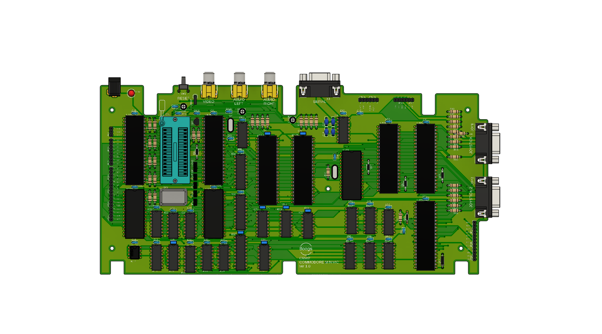
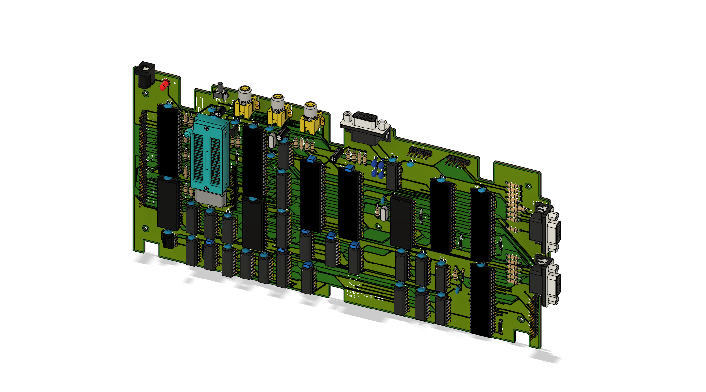
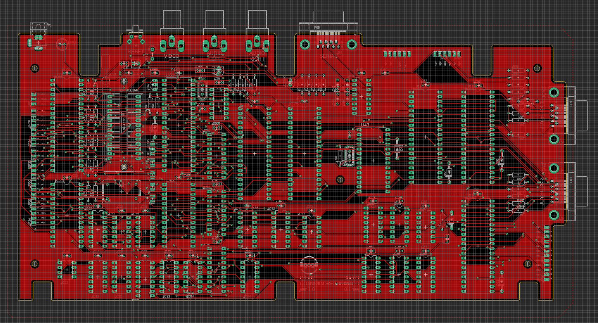

# miniVIC: 65C02-Based Arcade Computer

The **Boogs77-miniVIC** is a compact, arcade-oriented 8-bit computer built on a single board. It takes the modular architecture of the [BO6502 System](https://github.com/Boogs77/BO6502_65C02-based_modular_computer) and puts all of its modules on one PCB: a **W65C02S** CPU, a **TMS9918A** video processor with composite output, two **AY-3-8910** sound chips for stereo audio, a PS/2 keyboard, two joysticks, a serial port and an SD card for programs.

### ▶️ [Try it in the browser emulator](https://boogs77.github.io/BO6502-miniVIC-emulator/)

---

## 🧠 System Architecture & Modules

Every section of the board follows the electrical and logical design of a BO6502 module. The full schematic is in [`schematics/miniVIC_C6502_v40.pdf`](schematics/miniVIC_C6502_v40.pdf).

### ⚙️ Core Processing Unit (CPU, RAM, ROM)
* **CPU:** Western Design Center **W65C02S**. Reference: [BO6502 CPU](https://github.com/Boogs77/BO6502_65C02-based_modular_computer/tree/main/BO6502%20CPU).
* **Clock:** **1 MHz** crystal oscillator; the same clock drives the two AY-3-8910.
* **Reset:** **NE555** power-on and push-button reset. Reference: [BO6502 RESET](https://github.com/Boogs77/BO6502_65C02-based_modular_computer/tree/main/BO6502%20RESET).
* **RAM:** **HM62256** 32KB static RAM. Reference: [BO6502 RAM](https://github.com/Boogs77/BO6502_65C02-based_modular_computer/tree/main/BO6502%20RAM).
* **ROM:** **28C256** 32KB EEPROM on a ZIF socket, so the firmware can be updated without tools. Reference: [BO6502 ROM](https://github.com/Boogs77/BO6502_65C02-based_modular_computer/tree/main/BO6502%20ROM).
* **Interrupts:** the VIAs and the ACIA share **IRQ** through Schottky diodes; the video interrupt drives **NMI**.

### 📺 Video (TMS9918A)
* **Output:** composite video on an RCA connector, 256x192 pixels, 15 colours, 32 sprites.
* **VRAM:** 16KB on an **HM62256** static RAM, with two **74HC574** latches for the row/column address and a **74HC245** data buffer.
* **Addressing:** **$B000** (data) and **$B001** (registers/status); the vertical blank interrupt goes to **NMI** (60 Hz).
* **Reference:** [BO6502 VDU](https://github.com/Boogs77/BO6502_65C02-based_modular_computer/tree/main/BO6502%20VDU).

### 🔊 Audio (2 x AY-3-8910)
* **Output:** stereo, one chip per channel, each with its three voices mixed on an RCA connector.
* **Right channel:** latch **$D380**, write **$D381**.
* **Left channel:** latch **$D384**, write **$D385**.
* **Reference:** [BO6502 AUDIO](https://github.com/Boogs77/BO6502_65C02-based_modular_computer/tree/main/BO6502%20AUDIO).

### ⌨️ Keyboard Input (PS/2)
* **Interface:** a **W65C22** VIA reads the PS/2 keyboard through two **74HCT595** shift registers: each scancode arrives on PORTA, with a strobe on CA1.
* **Addressing:** **$D180**.
* **Reference:** [BO6502 KEYb](https://github.com/Boogs77/BO6502_65C02-based_modular_computer/tree/main/BO6502%20KEYb).

### 🕹️ Joysticks (W65C22 VIA)
* **Connectors:** two DB9 ports for Sega Master System style joysticks, with pull-up resistors.
* **Player 1:** PORTA at **$D581**. **Player 2:** PORTB at **$D580**.
* **Bits:** UP (bit0), DOWN (bit1), LEFT (bit2), RIGHT (bit3), button 1 (bit4), button 2 (bit5).
* **Reference:** [BO6502 JOYSTICK](https://github.com/Boogs77/BO6502_65C02-based_modular_computer/tree/main/BO6502%20JOYSTICK).

### 💾 SD Card (W65C22 VIA)
* **Interface:** SPI bit-banged on PORTA (MISO, MOSI, SCK, CS), with a header for an SD card module.
* **Addressing:** **$DD80**.
* **Cards:** SDSC and SDHC, read and write (BIOS KEYB/SD).
* **Reference:** [BO6502 SDCard](https://github.com/Boogs77/BO6502_65C02-based_modular_computer/tree/main/BO6502%20SDCard).

### 🔌 Serial Communication
* **Interface:** **W65C51** ACIA with a 1.8432 MHz crystal and a **MAX232** on a DB9 connector.
* **Addressing:** **$C000**.
* **Reference:** [BO6502 SERIAL](https://github.com/Boogs77/BO6502_65C02-based_modular_computer/tree/main/BO6502%20SERIAL).

### 🧩 Expansion
* Pin headers bring out the address bus, the data bus and PHI0, and the free lines of the SD card VIA.
* **Power:** 5V DC regulated, on a barrel jack with a power LED.

---

## 🗺️ Memory Map

| Address | Size | Device |
| :--- | :--- | :--- |
| **$0000-$7FFF** | 32KB | RAM |
| **$8000-$AFFF** | 12KB | ROM (Microsoft BASIC, BIOS) |
| **$B000** | page | VDU · TMS9918A |
| **$C000** | page | Serial I/O · W65C51 |
| **$D180** | 16 bytes | Keyboard · W65C22 |
| **$D380** | 8 bytes | Audio · 2x AY-3-8910 |
| **$D580** | 16 bytes | Joysticks · W65C22 |
| **$DD80** | 16 bytes | SD Card · W65C22 |
| **$E000-$FFFF** | 8KB | ROM (boot menu, jump table, WozMon, vectors) |

The ROM chip covers **$8000-$FFFF**, but the I/O area **$B000-$DFFF** is decoded to the devices.

---

## 💻 Software & Firmware

The firmware is published in its own repository: **[miniVIC BIOS](https://github.com/Boogs77/miniVIC_bios)** (`bin/boogs.bin`, the 32KB EEPROM image). The current version is **03.11.26 KEYB/SD**.

At power-on the BIOS shows a menu on the video output and on the serial terminal:
1. **WozMon**, the Apple I monitor.
2. **Microsoft BASIC 1977**.
3. **SD card programs menu**: games and applications on several pages, started with one key.
4. **System information**.

Programs loaded from the SD start at **$1000**, with an NMI trampoline at **$0FD0** that the BIOS calls on every vertical blank. They call the BIOS only through the jump table at **$FD00**: its addresses never move.

| Address | Entry | Function |
| :--- | :--- | :--- |
| **$FD00** | `JT_CHROUT` | print the character in A |
| **$FD03** | `JT_CHRIN_NOECHO` | read a key: C=1 and A=key, C=0 if none |
| **$FD06** | `JT_RESET_TERM` | reset the serial terminal |
| **$FD09** | `JT_INIT_CRT` | reset the video cursor |
| **$FD0C** | `JT_LOAD_RUN_SLOT` | load and run the SD program in slot A |
| **$FD0F** | `JT_SHOW_MENU` | back to the BIOS menu |
| **$FD12** | `JT_INIT_SDCARD` | load the SD program in slot A and return |
| **$FD15** | `JT_FLUSH_KB` | empty the keyboard buffer |
| **$FD18** | `JT_SD_READ_SECTOR` | read a 512 byte SD sector |
| **$FD1B** | `JT_SD_WRITE_SECTOR` | write a 512 byte SD sector |
| **$FD1E** | `JT_SD_INIT` | initialize the SD card |
| **$FD21** | `JT_KB_SET_MODE` | classic or extended keyboard (arrows, F1-F12, Ctrl, Alt) |

---

## 🎮 Games & Applications

* **[miniVIC Games](https://github.com/Boogs77/miniVIC_games):** a collection of arcade games in 65C02 assembly, with stereo music and records saved on the SD card.
* **[miniVIC Apps](https://github.com/Boogs77/miniVIC_apps):** office applications (Write, Calc, File, Desk, Term, Asm, Mon, Disk).
* **[BO6502 · miniVIC Emulator](https://github.com/Boogs77/BO6502-miniVIC-emulator):** runs the real BIOS, the games and the applications in the browser.

---

## 📋 Bill of Materials (BOM)

| Component | Description | Quantity |
| :--- | :--- | :--- |
| **W65C02S** | CMOS 8-bit Microprocessor | 1 |
| **HM62256** | 32K x 8 Static RAM (RAM and VRAM) | 2 |
| **28C256** | 32K x 8 EEPROM (on a 28-pin ZIF socket) | 1 |
| **TMS9918A** | Video Display Processor | 1 |
| **AY-3-8910** | Programmable Sound Generator | 2 |
| **W65C22 (VIA)** | Versatile Interface Adapter (keyboard, joysticks, SD) | 3 |
| **W65C51 (ACIA)** | Asynchronous Communications Interface Adapter | 1 |
| **MAX232** | RS-232 Line Driver | 1 |
| **NE555** | Timer (Reset Circuit) | 1 |
| **74AC138** | 3-to-8 Decoder | 7 |
| **74HC08** | Quad AND Gate | 4 |
| **74HCT00** | Quad NAND Gate | 2 |
| **74HC32** | Quad OR Gate | 1 |
| **74HCT04 / 74HC04** | Hex Inverter | 1 + 1 |
| **74HCT14** | Hex Schmitt Trigger Inverter | 1 |
| **74HCT595** | 8-bit Shift Register | 2 |
| **74HC574** | Octal D Flip-Flop | 2 |
| **74HC245** | Octal Bus Transceiver | 1 |
| **2N4401** | NPN Transistor (video output) | 1 |
| **Oscillator** | 1 MHz | 1 |
| **Crystals** | 10.738635 MHz (video), 1.8432 MHz (serial) | 1 + 1 |
| **Connectors** | DB9 (serial, 2x joystick), RCA (video, 2x audio), PS/2 keyboard, SD card module, DC jack | — |

---

## 🔗 Useful Links & Resources

* **Schematic:** [miniVIC C6502 v40 (PDF)](schematics/miniVIC_C6502_v40.pdf)
* **Firmware:** [miniVIC BIOS](https://github.com/Boogs77/miniVIC_bios)
* **Emulator:** [BO6502 · miniVIC Emulator](https://github.com/Boogs77/BO6502-miniVIC-emulator)
* **Games:** [miniVIC Games](https://github.com/Boogs77/miniVIC_games)
* **Applications:** [miniVIC Apps](https://github.com/Boogs77/miniVIC_apps)
* **BO6502 System:** [65C02-based Modular Computer](https://github.com/Boogs77/BO6502_65C02-based_modular_computer)
* **miniPET:** [The sister project](https://github.com/Boogs77/miniPET_65c02)

---

## 🖼️ Project Gallery

PCB ver 1.0: 3D render and copper layout.

  
  

---
*Created by Boogs77 - 2026*
